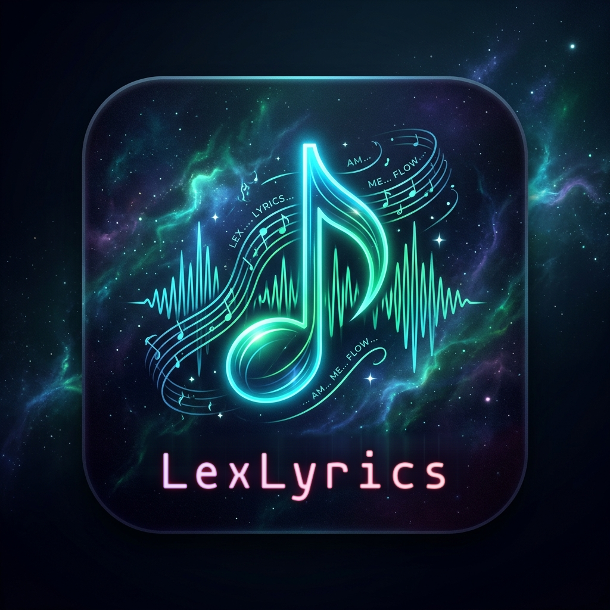
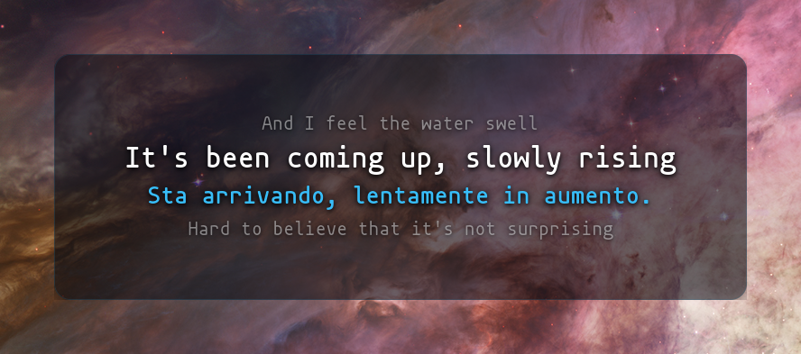
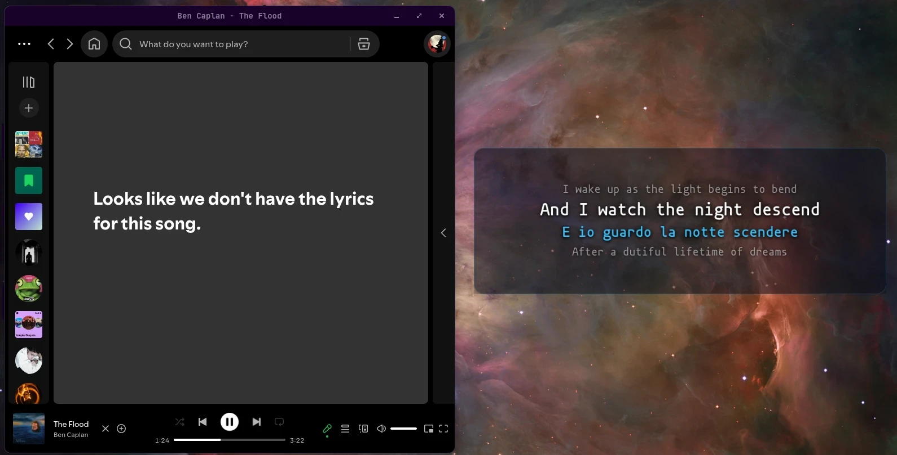
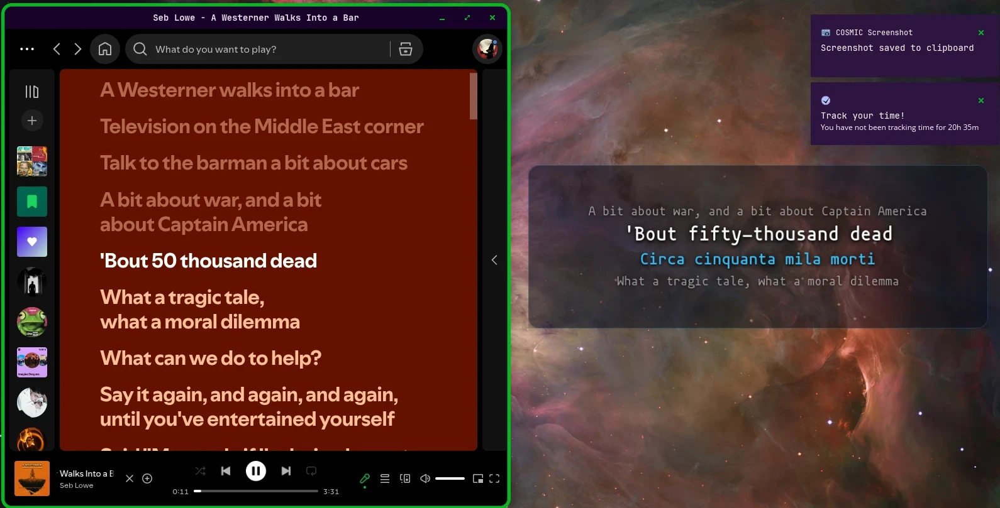
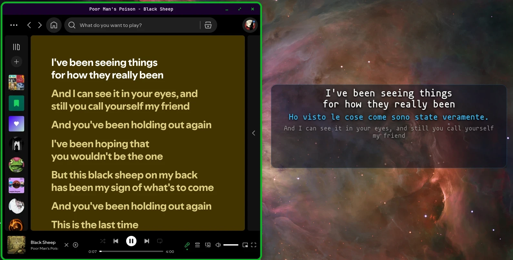
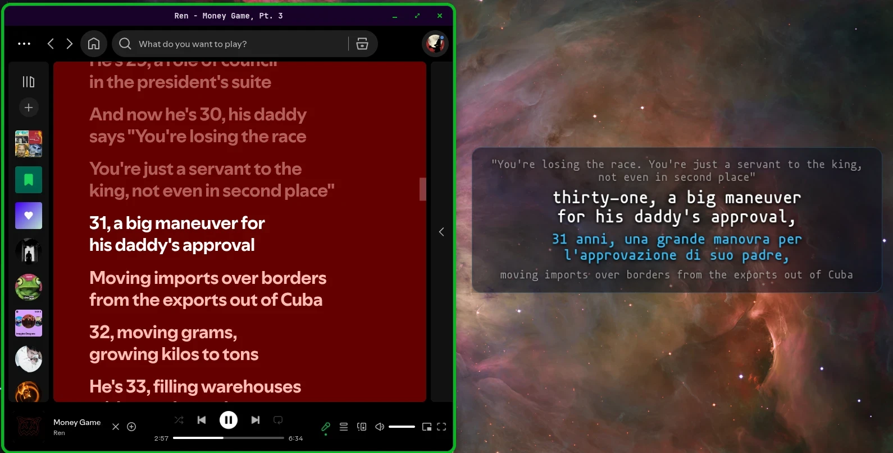

<div align="center">



# LexLyrics

**Barra karaoke in vetro per Linux e Windows, con traduzione italiana in tempo reale mentre la canzone suona.**

Fork di [Waylyrics](https://github.com/waylyrics/waylyrics) — sviluppato su Debian 13 + COSMIC e disponibile anche come eseguibile portatile per Windows 10/11.


</div>



## Come funziona

<table>
  <tr>
    <td></td>
    <td></td>
  </tr>
  <tr>
    <td align="center"><sub>Testo trovato anche dove Spotify non lo ha</sub></td>
    <td align="center"><sub>Riga corrente, traduzione e righe vicine</sub></td>
  </tr>
  <tr>
    <td></td>
    <td></td>
  </tr>
  <tr>
    <td align="center"><sub>Le righe lunghe vanno a capo</sub></td>
    <td align="center"><sub>Rap veloce, traduzione a tempo</sub></td>
  </tr>
</table>

LexLyrics si aggancia automaticamente al player in riproduzione (**MPRIS** su Linux, **SMTC** su Windows: Spotify, browser, VLC, MPD, Apple Music, Foobar2000…), scarica il testo sincronizzato e lo mostra in tempo reale sopra la dock o la taskbar:

- **righe precedenti / successive** in grigio soffuso (quante ne entrano nella barra, oppure un numero fisso);
- **riga attiva** in bianco ad alto contrasto;
- **traduzione italiana** in ciano sincronizzata sulla stessa battuta.

Prima dell'inizio del cantato mostra una scheda pulita con **titolo e artista**, filtrando via i crediti sporchi (`作曲 : …`).

## Cosa rende unico LexLyrics (v0.6.0)

- **Barra OSD compatta + HUD a schermo intero**:
  - **Barra OSD** (predefinita): striscia senza bordi con effetto vetro sempre in primo piano. Si **trascina col mouse** e si **ridimensiona da bordi e angoli**; si adatta automaticamente se cambi monitor o scala HiDPI.
  - **HUD a schermo intero**: solo il testo fluttuante sul desktop; tutto il resto dello schermo resta **sempre click-through** (non copre né blocca mai barra/dock) e con **`Esc` / `F11`** torni all'istante alla barra OSD.
- **Zoom fluido**: `Alt` + rotellina (o `Super` + rotellina) ridimensiona insieme carattere e barra mantenendo fermo l'ancoraggio inferiore.
- **Traduzione neurale a doppio stadio (0 MB VRAM a riposo)**:
  1. **Istantanea (< 1 s)**: demone locale **NLLB-200 (600M)** multithread a blocchi di 8 righe. Sale su GPU quando apri LexLyrics, scende a `0 MB` di VRAM quando lo chiudi e passa da solo su CPU se la VRAM è occupata da un LLM locale.
  2. **Rifinitura d'autore via LLM**: in background (`agy`, `hermes` o `claude`) riscrive l'intero brano in italiano naturale rispettando slang, metafore e intensità, salvando il risultato in cache una volta per tutte.
  3. **Rilevamento italiano**: se la canzone è già in italiano, salta automaticamente la traduzione.
- **Ricerca testi intelligente**: interroga **LRCLib** e **NetEase**, ripulisce i suffissi di Spotify (`- Original Mix`, `- Remastered`, `(feat. …)`), ordina i candidati per durata + somiglianza fuzzy e, se manca il file `.lrc` sincronizzato, distribuisce il testo semplice sulla durata del brano.
- **Tray icon ♫ ed editor live**: su Linux clic sinistro apre l'editor TUI `lexlyrics-theme` (font, colori, opacità, raggio e vetro a caldo); clic destro su Linux e Windows controlla modalità finestra, zoom, click-through (`Alt+P`), player e ricerca testi.
- **Multipiattaforma vero**: pacchetto nativo `.deb` / `.tar.gz` per Linux e archivio portatile `.zip` con `lexlyrics.exe` per Windows 10/11.

### Altre lingue di destinazione

L'italiano (`ita_Latn`) viene tradotto interamente in locale con NLLB-200 + LLM. Impostando altre lingue (`de`, `fr`, `es`, `ja` o codici NLLB come `deu_Latn`), LexLyrics usa come fallback l'API gratuita [MyMemory](https://mymemory.translated.net/) (5 000 caratteri/giorno gratis, 50 000 con `api_email`).

---

## Installazione rapida

### Linux — Pacchetto Debian / Ubuntu / COSMIC

Scarica il `.deb` dalle [Release](https://github.com/pipix92/lexlyrics/releases) oppure generalo in locale con Podman rootless:

```bash
./scripts/package_deb.sh
sudo apt install ./lexlyrics_0.6.0-1_amd64.deb
```

Installa `lexlyrics`, l'editor `lexlyrics-theme`, i temi, le icone e gli schemi GSettings. Su altre distribuzioni puoi estrarre `lexlyrics-v0.6.0-linux-x86_64.tar.gz` e lanciare direttamente `./lexlyrics`.

### Windows 10 / 11 (x64)

1. Scarica **`lexlyrics-v0.6.0-windows-x86_64.zip`** dalle [Release](https://github.com/pipix92/lexlyrics/releases) (oppure generalo da Linux con `./scripts/package_windows.sh`).
2. Estrai la cartella dove preferisci e avvia **`lexlyrics.exe`** (nessun installer richiesto: runtime GTK4, schemi e temi sono già inclusi).
3. Per la traduzione locale offline anche su Windows: avvia `python contrib/nllb-translator/nllb-translation-server.py` (oppure usa `backend = "api"` in `%APPDATA%\waylyrics\waylyrics\config\config.toml`).

### Compilazione da sorgente (Linux)

```bash
sudo apt install libgtk-4-dev libdbus-1-dev libssl-dev libx11-dev
cargo build --release
WAYLYRICS_THEME_PRESETS_DIR=$PWD/themes ./target/release/lexlyrics
```

### Demone di traduzione NLLB-200 (`contrib/nllb-translator`)

```bash
cd contrib/nllb-translator
./install.sh   # crea il venv, scarica facebook/nllb-200-distilled-600M e attiva il servizio systemd --user
```

Per la rifinitura testuale basta avere `agy`, `hermes` o `claude` nel `PATH` (altrimenti imposta `refine_backend = "none"`).

> Su Linux LexLyrics imposta `GDK_BACKEND=x11` (XWayland) di default per evitare il bug DMABUF di GTK 4.18 su COSMIC e permettere il posizionamento millimetrico della barra OSD.

---

## Configurazione

File `~/.config/waylyrics/config.toml` su Linux (`%APPDATA%\waylyrics\waylyrics\config\config.toml` su Windows), oppure tramite `lexlyrics-theme`:

```toml
theme = "lexlyrics-karaoke"
start-fullscreen = false      # false = Barra OSD compatta; true = HUD a schermo intero (Esc/F11 per uscire)
window-width = 1200           # dimensioni della barra a zoom 1.0
window-height = 210
osd-dock-margin = 64          # margine sopra la dock / taskbar
lyric-offset-x = 0            # 0, 0 = centrato in basso in automatico
lyric-offset-y = 0
passthrough-by-default = false
zoom = 1.0                    # 0.5 – 3.0 (anche con Alt + rotellina)
context-lines = -1            # -1 = automatico in base all'altezza, oppure 0–8 fisse
lyric-search-source = ["LRCLib", "网易云音乐"]

[translation]
backend = "nllb"              # nllb | marian | agy | claude | hermes | api
nllb_url = "http://127.0.0.1:18436/translate"
target_lang = "ita_Latn"      # italiano offline; altre lingue via API
refine_backend = "agy"        # agy | hermes | claude | none
refine_timeout_s = 180
api_url = "https://api.mymemory.translated.net/get"
api_email = ""
```

## Crediti e Licenza

- Basato su [Waylyrics](https://github.com/waylyrics/waylyrics) di poly000 e contributori.
- Testi da [LRCLib](https://lrclib.net/) e NetEase; traduzione neurale offline tramite [Meta NLLB-200](https://ai.meta.com/research/no-language-left-behind/).
- Sfondo degli screenshot: Nebulosa di Orione, NASA/ESA (dominio pubblico).

Rilasciato sotto licenza **MIT** — vedi [LICENSE](LICENSE).
