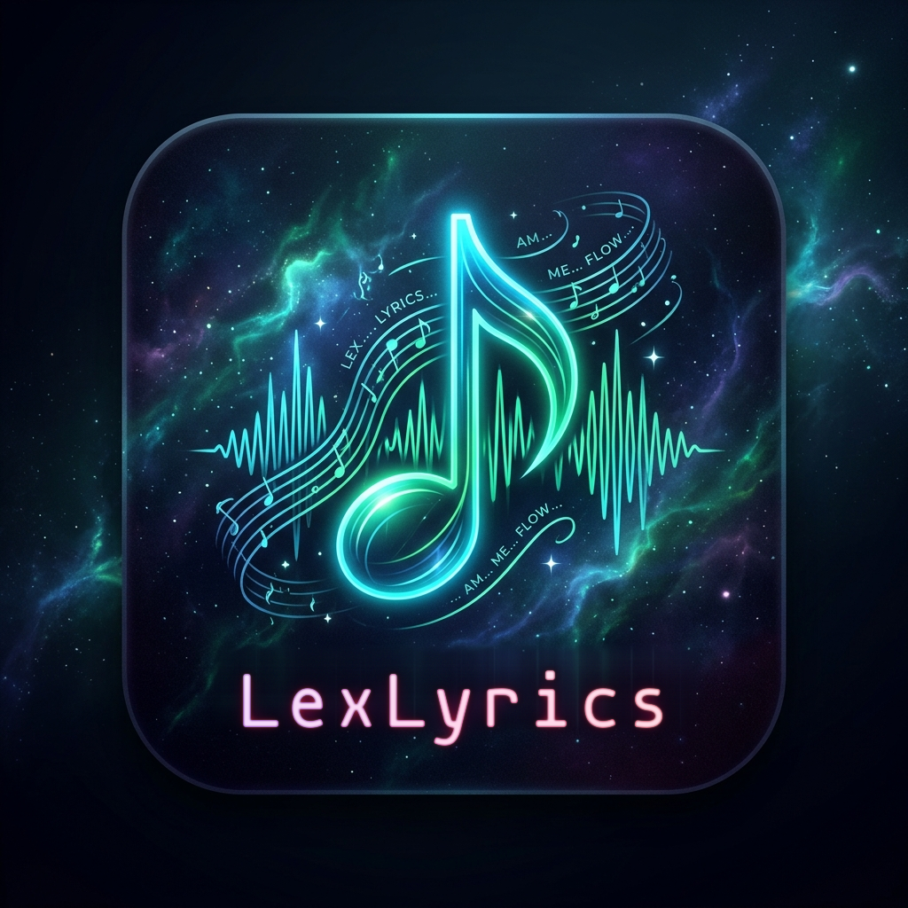
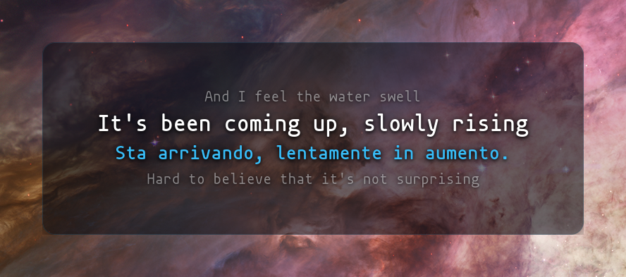
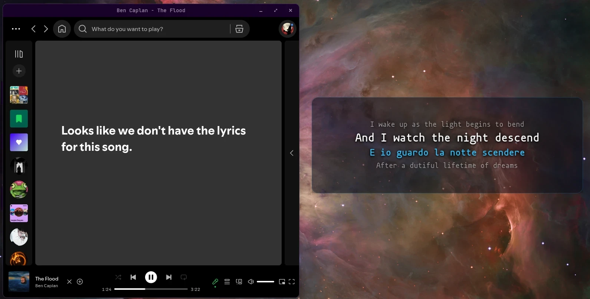
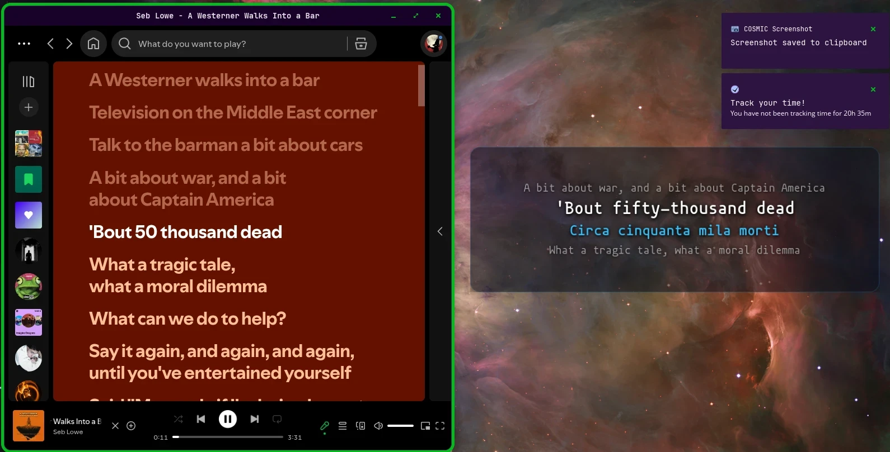
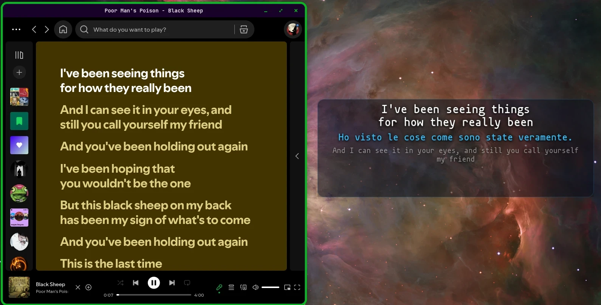
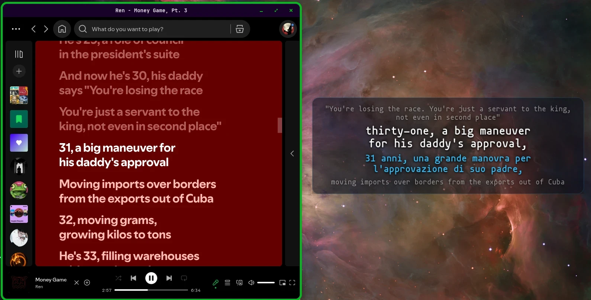

<div align="center">



# LexLyrics

**Barra karaoke per il desktop Linux, con la traduzione italiana mentre la canzone suona.**

Fork di [Waylyrics](https://github.com/waylyrics/waylyrics), sviluppato e testato su Debian 13 + COSMIC.


</div>



## Come funziona

<table>
  <tr>
    <td></td>
    <td></td>
  </tr>
  <tr>
    <td align="center"><sub>Testo trovato anche dove Spotify non lo ha</sub></td>
    <td align="center"><sub>Riga corrente, traduzione e righe vicine</sub></td>
  </tr>
  <tr>
    <td></td>
    <td></td>
  </tr>
  <tr>
    <td align="center"><sub>Le righe lunghe vanno a capo</sub></td>
    <td align="center"><sub>Rap veloce, traduzione a tempo</sub></td>
  </tr>
</table>

LexLyrics legge il brano in riproduzione via MPRIS (Spotify, browser, VLC, MPD…), scarica il testo sincronizzato e lo mostra in una barra sopra la dock:

- **riga precedente / successiva** in grigio (quante ne stanno, oppure un numero fisso);
- **riga corrente** in bianco;
- **traduzione italiana** in ciano, allineata alla stessa riga.

Prima della prima strofa la barra mostra titolo e autore.

## Funzionalità

- **Barra OSD**: barra senza bordi con sfondo vetro, sempre in primo piano, in basso al centro sopra la dock. Si **sposta trascinandola** e si **ridimensiona dai bordi e dagli angoli** come una finestra normale; posizione e dimensioni restano salvate.
- **Zoom**: `Alt` + rotellina (o `Super` + rotellina) sopra la barra ingrandisce o riduce testo e barra insieme, tenendo fermo il centro in basso.
- **Righe di contesto**: con `context-lines = -1` le righe grigie prima e dopo crescono con l'altezza della barra; altrimenti 0–8 fisse.
- **Traduzione veloce**: NLLB-200 (600M) in locale, su GPU quando disponibile: le prime righe sono tradotte in meno di un secondo, a blocchi di 8.
- **Traduzione rifinita**: subito dopo, un LLM (`agy`, `hermes` o `claude` da riga di comando) riscrive l'intera canzone in italiano naturale: gergo e parolacce con la stessa forza, modi di dire tradotti per significato. Il risultato va in cache, una volta per brano.
- **Fonti dei testi**: LRCLib e NetEase. Se nessuno ha la versione sincronizzata, usa il testo semplice di LRCLib con tempi stimati sulla durata del brano. I crediti cinesi di NetEase (`作曲 : …`) vengono nascosti.
- **Icona tray ♫**: clic sinistro: editor di tema e finestra. Clic destro: righe prima/dopo, barra OSD o HUD a schermo intero, più grande/più piccolo, riporta sopra la dock, click-through, player, ricerca testo.
- **Click-through**: `Alt+P` o dal tray: i clic attraversano la barra, che diventa più tenue per segnalarlo.
- **HUD a schermo intero**: alternativa alla barra: solo il testo sopra il desktop (`start-fullscreen = true`).

### 🚧 Work in progress: altre lingue

L'italiano è tradotto in locale. Le altre lingue di destinazione (`target_lang = "de"`, `"fr"`, `"es"`, `"ja"`… o i codici NLLB come `deu_Latn`) per ora passano da un'API esterna ([MyMemory](https://mymemory.translated.net/), gratuita: 5000 caratteri al giorno, 50000 impostando `api_email`). La traduzione locale per tutte le lingue arriverà in seguito.

## Installazione

### Pacchetto Debian

```bash
./scripts/package_deb.sh          # compila in un container Podman e crea il .deb
sudo apt install ./lexlyrics_0.5.0-1_amd64.deb
```

Il pacchetto installa `lexlyrics`, l'editor `lexlyrics-theme`, i temi, le icone e lo schema GSettings.

### Da sorgente

```bash
sudo apt install libgtk-4-dev libdbus-1-dev libssl-dev libx11-dev
cargo build --release
WAYLYRICS_THEME_PRESETS_DIR=$PWD/themes ./target/release/lexlyrics
```

### Traduzione locale (consigliata)

Il demone NLLB-200 è in [`contrib/nllb-translator`](contrib/nllb-translator/): occupa 0 MB di VRAM a riposo e sale su GPU in circa 0,7 s quando LexLyrics si avvia. Per la rifinitura serve uno tra `agy`, `hermes` o `claude` nel `PATH`; senza, resta la traduzione veloce (`refine_backend = "none"`).

> LexLyrics usa XWayland (`GDK_BACKEND=x11`) di default: evita un crash di GTK 4.18 sul Wayland di COSMIC ed è ciò che permette alla barra di posizionarsi da sola.

## Configurazione

`~/.config/waylyrics/config.toml`, oppure dall'editor (clic sinistro sull'icona ♫ o `lexlyrics-theme` da terminale).

```toml
theme = "lexlyrics-karaoke"
start-fullscreen = false      # barra OSD; true = HUD a schermo intero
window-width = 1200           # dimensioni della barra a zoom 1.0
window-height = 210
osd-dock-margin = 64          # distanza dal bordo inferiore
lyric-offset-x = 0            # 0, 0 = sopra la dock in automatico
lyric-offset-y = 0
passthrough-by-default = false
zoom = 1.0                    # 0.5 – 3.0, anche con Alt + rotellina
context-lines = -1            # -1 = quante ne stanno, 0–8 fisse
lyric-search-source = ["LRCLib", "网易云音乐"]

[translation]
backend = "nllb"              # nllb | marian | agy | claude | hermes | api
nllb_url = "http://127.0.0.1:18436/translate"
target_lang = "ita_Latn"      # italiano in locale; altre lingue via API (WIP)
refine_backend = "agy"        # agy | hermes | claude | none
refine_timeout_s = 180
api_url = "https://api.mymemory.translated.net/get"
api_email = ""
```

L'editor `lexlyrics-theme` genera `~/.local/share/waylyrics/_themes/lexlyrics-custom.css` (font, dimensioni, colori di originale e traduzione, opacità delle righe vicine, vetro, angoli e bordo della barra) e lo ricarica a caldo.

## Crediti

- [Waylyrics](https://github.com/waylyrics/waylyrics) di poly000 e contributori, base di questo fork.
- [LRCLib](https://lrclib.net/) e NetEase per i testi, [NLLB-200](https://ai.meta.com/research/no-language-left-behind/) di Meta per la traduzione locale.
- Sfondo degli screenshot: Nebulosa di Orione, NASA/ESA (dominio pubblico).

Licenza **MIT**, come il progetto originale: vedi [LICENSE](LICENSE).
